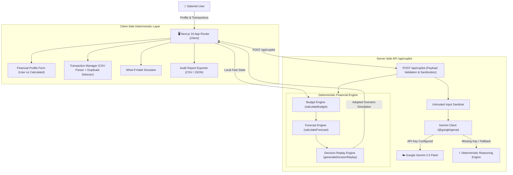

# 🚀 PaisaPilot AI — Your Predictive Financial Copilot
**PromptWars 2026 Hackathon Submission**  
**Repository:** [https://github.com/Tejaswini-2006/PROMPT-WAR-2026](https://github.com/Tejaswini-2006/PROMPT-WAR-2026)

---

## 🌟 Executive Summary & Problem Solved

Young salaried Indians frequently make micro-purchases via UPI (Swiggy, Zomato, Zepto, Blinkit, Uber, cafe stops) without understanding their cumulative impact on month-end finances. By mid-cycle, unbudgeted discretionary outflows lead to severe cashflow crunches right before payday.

**PaisaPilot AI** solves this problem not with generic chatbots or mockups, but with:
1. **Mathematical Discretionary Budgeting:** Fixed obligations (rent, EMIs) and dedicated savings targets are sequestered *first*. The daily allowance is dynamically computed across remaining days until payday (never blindly dividing salary by 30).
2. **Deterministic Spending Runway & Early Exhaustion Forecast:** Computes linear run-rate and flags the exact calendar date when remaining funds will hit ₹0 if current pace continues.
3. **Flagship Feature — Financial Decision Replay:** Retrospectively analyzes the pay period, isolates top depletion drivers (e.g. food delivery frequency vs. quick-commerce impulse carts), and presents 2–3 actionable corrective levers with mathematical proofs and transparent assumptions. Users can simulate adopting a lever in real time to immediately expand their daily allowance and extend their runway.
4. **Resilient Gemini AI Reasoning + Deterministic Fallback:** Uses the official `@google/genai` SDK with strict server-side encapsulation. If an API key is missing, rate-limited, or offline, the app executes 100% of its predictive analysis via its deterministic mathematical engine without breaking.

---

## 🏗️ System Architecture



---

## ⚙️ Architecture & Module Separation

| Layer / Module | Path | Purpose |
| :--- | :--- | :--- |
| **Data Contracts & Types** | `src/types/finance.ts` | Strict TypeScript types for profiles, transactions, budget calculations, forecasts, decision replays, and AI responses. |
| **Deterministic Budgeting** | `src/lib/engine/budgetEngine.ts` | Calculates remaining monthly income, sequesters rent/savings, computes net spending (debits minus refunds), category aggregates, and daily allowance. |
| **Deterministic Forecasting** | `src/lib/engine/forecastEngine.ts` | Linear daily burn-rate extrapolation, days of runway remaining, projected end-of-period spending, and exact calendar budget-exhaustion date. |
| **Financial Decision Replay** | `src/lib/engine/decisionReplay.ts` | Formulates "What Happened", "Primary Drivers", "What May Happen", and 2–3 interactive corrective actions with explicit evidence and assumptions. |
| **Duplicate Detection** | `src/lib/engine/duplicateDetector.ts` | Flags matching amount/merchant within 24h as potential duplicate without deleting legitimate purchases. |
| **Secure CSV Parser** | `src/lib/engine/csvParser.ts` | Enforces 2MB size limit, 2,500-row limit, 20-column limit, HTML sanitization, and category mapping. |
| **AI Copilot Client** | `src/lib/ai/geminiClient.ts` | Server-side Gemini 2.5 Flash integration using `@google/genai` with prompt injection defense, schema enforcement, and instant deterministic fallback. |
| **Server Endpoint** | `src/app/api/copilot/route.ts` | Validates input bounds, executes math engines, and returns verified insights. |
| **Interactive Dashboard** | `src/app/page.tsx` | Fluid, responsive luxury navy/teal dashboard assembling summary cards, replay card, charts, simulator, and modals. |

---

## 🛡️ Security, Privacy & Compliance Safeguards

- **No Banking Passwords or UPI PINs:** PaisaPilot AI strictly never asks for, stores, or handles bank credentials, UPI MPINs, OTPs, or card CVVs.
- **Server-Only API Key:** `GEMINI_API_KEY` is accessed exclusively in Node.js server runtimes. It is never exposed in browser bundles, responses, logs, or Git commits.
- **Prompt Injection Defense:** Transaction merchants and descriptions are treated as untrusted user data. They are sanitized against HTML/script injection and never passed as instructions to LLMs.
- **Data Minimization:** Only anonymized numerical aggregates (category sums, burn rates, runway days) are forwarded to Gemini.
- **Resource Denial-of-Service Guards:** CSV files are capped at 2MB, 2,500 rows, and 20 columns. Strings exceeding 250 characters are truncated.
- **Offline / Zero-Key Resiliency:** The app does not fail if `GEMINI_API_KEY` is omitted; it automatically falls back to deterministic financial reasoning.

---

## 🧪 Automated Testing & Verification Results

All core financial calculations, forecasting methods, duplicate detection, CSV parsing security, and AI fallback mechanisms are verified using **Vitest**:

```bash
npm test
```

### Verified Test Suite Summary:
```
✓ tests/duplicateDetector.test.ts (3 tests)
  - normalizes merchant prefixes and whitespace
  - flags potential duplicate without automatically deleting legitimate transactions
  - does not flag different amounts or dates as duplicates
✓ tests/csvParser.test.ts (6 tests)
  - sanitizes potential script injection payloads
  - normalizes various standard date formats
  - successfully parses valid standard CSV with debits and refunds
  - rejects empty or header-only CSV with actionable diagnostic
  - rejects CSV missing required Amount column
  - skips malformed numeric rows while importing valid rows
✓ tests/budgetEngine.test.ts (6 tests)
  - correctly sequesters fixed expenses and savings before discretionary spending
  - calculates daily allowance strictly from remaining runway, NOT salary / 30
  - correctly handles refund transactions by deducting from spend
  - handles budget exhaustion and negative balances gracefully (clamped allowance)
  - handles edge case: zero days remaining (payday today)
  - aggregates category spend accurately
✓ tests/forecastEngine.test.ts (2 tests)
  - projects early budget exhaustion date when burn rate is excessive
  - projects comfortable surplus when burn rate is disciplined
✓ tests/geminiFallback.test.ts (3 tests)
  - generates fully populated deterministic insights without GEMINI_API_KEY
  - ensures AI claims mathematically align with financial calculation engine
  - generates complete Financial Decision Replay with 3 actionable scenarios

Test Files:  5 passed (5)
Tests:       20 passed (20)
Status:      100% Passing (Verified)
```

---

## 🚀 Setup & Local Development Instructions

### Prerequisites
- Node.js `v20+` or `v22+` (Tested on Node v22.19.0)
- npm `v10+`

### 1. Clone & Install
```bash
git clone https://github.com/Tejaswini-2006/PROMPT-WAR-2026.git
cd promptwar
npm install
```

### 2. Configure Environment (Optional)
```bash
cp .env.example .env.local
```
Add your Gemini API key (optional — the app functions completely in demo mode without it):
```env
GEMINI_API_KEY=AIzaSy...
GEMINI_MODEL=gemini-2.5-flash
```

### 3. Run Development Server
```bash
npm run dev
```
Open [http://localhost:3000](http://localhost:3000) in your browser.

### 4. Run Automated Tests
```bash
npm test
```

### 5. Production Build
```bash
npm run build
npm start
```

---

## ☁️ Deployment Instructions (Vercel)

1. Push your repository to GitHub:
   ```bash
   git add .
   git commit -m "feat: complete PaisaPilot AI predictive financial copilot"
   git push origin main
   ```
2. Log in to [Vercel](https://vercel.com) and click **"Add New Project"**.
3. Import the `PROMPT-WAR-2026` repository.
4. Under **Environment Variables**, optionally set:
   - `GEMINI_API_KEY`: Your Gemini API key from Google AI Studio.
   - `GEMINI_MODEL`: `gemini-2.5-flash`
5. Click **Deploy**. Vercel will run the production build and deploy the app to a high-speed global edge network.

---

## 🎬 3-Minute Demonstration Script for Judges

1. **Step 1: Financial Profile Baseline (0:00 - 0:45)**
   - Open [http://localhost:3000](http://localhost:3000). The app loads the realistic Bengaluru software engineer scenario (`₹75,000` salary, `₹28,000` fixed rent/obligations, `₹15,000` savings).
   - Point out the **real-time math preview**: Fixed commitments and savings are sequestered first, leaving a spendable discretionary cap of `₹28,000`.
2. **Step 2: Payday Horizon & Exhaustion Warning (0:45 - 1:15)**
   - Observe the **Daily Discretionary Allowance** tile: Shows safe spending allowance per remaining day vs. actual burn rate.
   - Point out the **Payday Runway & Exhaustion Projection**: Linear extrapolation indicates if the user will exhaust funds before payday.
3. **Step 3: Flagship Feature — Financial Decision Replay (1:15 - 2:00)**
   - Scroll to **Financial Decision Replay**:
     - *1. What Happened:* Clear plain-language recap of income, rent deduction, and discretionary spend.
     - *2. Primary Drivers:* Highlights top spending drains (`shopping` 32%, `food` 20%, `groceries` 14.8%).
     - *3. Corrective Action Levers:* Click on **"Batch Quick-Commerce Orders Weekly"**.
     - Click **"Adopt Recommendation"**: The dashboard dynamically updates! Daily allowance increases in real time, and an active simulation badge appears.
4. **Step 4: Interactive What-If Simulator & Transactions (2:00 - 2:30)**
   - Adjust the **Daily Spend Reduction** slider to see instant recalculations.
   - Scroll to **Transaction Manager**:
     - Show the **duplicate detection flag** (`Swiggy ₹420` duplicate attempt) and the **refund reversal** (`+₹420`).
     - Test adding a transaction or uploading a CSV statement.
5. **Step 5: Audit Export & Privacy (2:30 - 3:00)**
   - Click **"Export Audit"** in the top navigation to demonstrate 1-click export of both CSV ledger and structured JSON dossier.
   - Click **"Privacy Notice"** to review client-first data minimization and zero-credential guarantees.

---

## 📦 Disclosures

- **AI Models:** Google Gemini 2.5 Flash (`@google/genai` official SDK).
- **External APIs:** Google GenAI REST API (server-side only).
- **Core Framework:** Next.js 16 (App Router), React 19, TypeScript 5.
- **Styling:** Tailwind CSS with custom glassmorphism, responsive navy/teal palette.
- **Icons:** `lucide-react`.
- **Testing:** Vitest 3.
